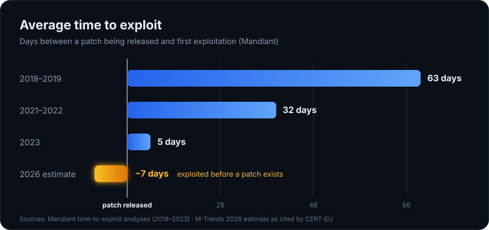

For years the deal was simple: a vendor publishes a fix, you roll it out in your next patch window, and you are reasonably safe in between. That deal is gone. The window between “a vulnerability becomes known” and “someone is exploiting it” has shrunk to days, and for a good share of vulnerabilities it is now zero or less.

AI didn't start that trend: the window was already shrinking years before. But according to CERT-EU, AI is now pouring fuel on it (how much is harder to prove than it sounds, more on that [below](#a-caveat-on-the-ai-part)). CERT-EU warned in April 2026 that AI now finds and weaponises vulnerabilities faster than the classic discover, disclose, patch, deploy cycle can keep up with.

Patching is still mandatory. But if your security only works *after* the patch is installed, there is a gap you can't close by patching faster. This post is about the control that covers that gap, and it isn't new at all: **network segmentation**.

> Figures are taken from the sources linked at the end and reflect what they reported up to 30 October 2026. Different vendors measure “time to exploit” differently, so compare trends, not single numbers.

## The window is gone

Mandiant has tracked “time to exploit” for years: the average number of days between a patch being released and the first exploitation. A negative number means attackers were in before the patch existed.

The 2023 analysis covered 138 vulnerabilities exploited in the wild, and 97 of them were exploited as zero-days. Mandiant calls its figures conservative, and the five-day average leaves out 15 outliers. With them included, it rises to 47 days. The −7 figure comes from Mandiant's M-Trends 2026 report, as cited by CERT-EU.

VulnCheck looks at the same problem from another angle: how many known exploited vulnerabilities showed exploitation **on or before the day the CVE was published**? In 2025 it was **28.93%**. In the first half of 2026 it was **23.43%**, out of 495 newly known exploited vulnerabilities.

Two things are worth keeping in mind:

- **It isn't all fast.** VulnCheck's median time from CVE publication to known exploitation was still 80 days in the first half of 2026. Many vulnerabilities are exploited months or years later. The fast ones are the leading edge, but they are exactly the ones a monthly patch cycle can't catch.
- **The targets are predictable.** Content management systems made up about a third of VulnCheck's newly exploited vulnerabilities, and the list of edge-device vendors (firewalls, VPN gateways, remote access appliances) is long. Those are the systems that face the internet.

CrowdStrike's 2026 threat report adds concrete cases from 2025. Note that each one is counted from a different starting point:

| Vulnerability | Exploited after | Counted from |
| --- | --- | --- |
| CVE-2025-55182 (React2Shell) | 2 days | public disclosure by researchers |
| CVE-2025-31324 | 3 days | the vendor's disclosure |
| CVE-2025-25257 | 6 days | publication of a proof-of-concept exploit |

All three were exploited by China-linked groups, so they show how fast it can go, not how fast it usually goes.

Compare that with a typical enterprise patch cycle of 30 to 60 days, a range CERT-EU cites as well. The maths doesn't work out.

### A caveat on the AI part

“AI accelerates exploitation” is a plausible claim, and CERT-EU makes it. But the numbers above don't prove it, and blaming AI for the trend may be an attribution error:

- **The curve started before AI.** Time to exploit fell from 63 to 5 days between 2018 and 2023, before generative AI was of much use for exploit development.
- **There are other drivers.** More zero-day exploitation by state actors and ransomware groups, a focus on edge devices that are hard to monitor, a professional exploit market and simply more CVEs being published every year.
- **The measurement changes too.** Better detection and reporting find more early exploitation that would have gone unnoticed before. CERT-EU says this openly about its own 2025 report: part of the year-on-year increase in tracked attackers and targeted software reflects its own expanded use of automation and AI in monitoring, not only more threats.
- **The data doesn't record it.** None of the sources tell you whether a given exploit was written with the help of AI.

Even a vendor that sells AI-powered defence is careful here. CrowdStrike's 2026 report concludes that AI so far mostly improves techniques attackers already use, rather than creating new ones. The first LLM-powered malware it describes from a state actor showed no meaningful gain in effectiveness. And its headline figure of 89% more attacks by “AI-enabled adversaries” counts attacks by groups that use AI. It doesn't show that AI made those attacks faster.

CERT-EU's 2025 report points the same way. The AI effect it documents most clearly is on social engineering, such as voice cloning, deepfakes of officials and tailored phishing, not on how fast vulnerabilities are exploited. The counterexample is real too: in September 2025, a reportedly China-linked group pointed a jailbroken AI agent at about 30 organisations and achieved autonomous intrusion in a small number of cases.

So AI may well be speeding things up, but I can't show from public data how much of the trend it explains. For this post it doesn't matter much: the window was shrinking anyway, and segmentation helps either way.

## Why an old answer still works

Segmentation is about as unglamorous as security gets. DMZs, VLANs, firewall rules between zones: Humanity has been doing this since the 1990s. That is also its strength:

- **It doesn't care which CVE it is.** A rule that stops the VPN appliance from talking to workstations works on day −7, day 0 and day 300, whether or not a patch exists.
- **It limits the blast radius.** If an exposed system falls, the attacker gets that system and what it is allowed to reach, not the whole network.
- **It buys time.** An attacker who has to break through a second and third boundary needs time and makes noise. That's time for you to patch and noise for you to detect. And it has to be in place beforehand: CrowdStrike measured an average “breakout time”, from the first foothold to the next system, of 29 minutes for criminal groups in 2025. The fastest was 27 seconds. Nobody redesigns a firewall in 27 seconds.
- **It creates chokepoints you can watch.** Traffic between zones passes through a few places you can log. A flat network gives you nothing to look at.

For a defender, that last point matters as much as the blocking. The question is no longer only “can we keep them out?” but “when they get in, how far do they get, and will we see it?”.

Segmentation reduces the attacker's opportunities, but it isn't an absolute security boundary. Allowed flows can be abused: the VPN gateway has to talk to your directory and the web server to its database, and an attacker will use exactly those paths. Stolen credentials work across zones, which is why segmentation needs an identity counterpart: **tiering**. Accounts that administer domain controllers and other Tier 0 systems never sign in to ordinary servers or workstations, so a compromised laptop doesn't hold the keys to the whole domain. And the firewall enforcing the boundary is itself a device with vulnerabilities: in 2025, an unknown attacker broke into two FortiGate firewalls of an EU institution, very likely through a remote code execution flaw. Segmentation makes the attacker's path longer, narrower and louder. It doesn't make it impossible.

## What the 2026 threat data shows

Start with data that doesn't come from a vendor. CERT-EU handled nine significant incidents at EU institutions in 2025. **Seven of them started with the exploitation of a vulnerability**: two zero-days, two attacks on industrial control systems and one firewall compromise among them. For the second year in a row, exploiting internet-facing software was the way in with the highest impact. CERT-EU's conclusion is to put patching first: it calls timely patching of internet-facing systems “the single highest-priority defensive action”. Segmentation is what's left when patching comes too late.

CrowdStrike's 2026 Global Threat Report, which also covers 2025, shows the same pattern and adds detail. It is a vendor report based on what CrowdStrike sees at its own customers, so read it as one view, not the whole picture.

- **Edge devices are a preferred way in.** When China-linked groups exploited a vulnerability during an intrusion, the target was an edge device in 40% of cases. CrowdStrike points out that these devices often have little EDR coverage, reduced logging and inconsistent patching.
- **The way in is the start, not the end.** WARP PANDA moved from compromised VPN appliances into VMware vCenter. In one intrusion, the group stayed undetected for 22 months. Exploiting a vulnerability takes minutes. The access it buys can last for years.
- **One blocked path isn't enough.** In one intrusion at a law firm, attackers talked an employee into granting access via Quick Assist. Less than three minutes later they tried to upload data with WinSCP, and the firewall blocked it. Ten seconds after that, they opened Google Drive and used that instead. CrowdStrike caught it before the upload finished, but the firewall alone wouldn't have.

The recommendations read like this post: patch edge devices within 72 hours of a critical disclosure, monitor them and establish “network segmentation to limit lateral movement from compromised perimeter systems”.

Your VPN gateway might eventually get compromised. What matters is what an attacker can reach from there.

## What CERT-EU recommends

CERT-EU, the cybersecurity service for the EU institutions, bodies and agencies, addresses exactly this.

**April 2026: “AI is changing the economics of vulnerability discovery”.** The argument: AI finds and exploits vulnerabilities faster than the classic discover, disclose, patch, deploy cycle can handle. The recommendations read like a segmentation brief:

- **Reduce the attack surface:** switch off unnecessary internet-facing services, close unused ports, remove legacy systems and *enforce network segmentation*.
- **Patch exposed systems fast:** for critical vulnerabilities on exposed assets, aim for remediation “within days, not weeks”. Internet-facing systems and edge devices should be patched without delay.
- **Use compensating controls when you can't patch yet:** a web application firewall, network segmentation and temporary access restrictions, deployed immediately.
- **Keep the basics tight:** rotate credentials, keep an accurate asset inventory and deploy **phishing-resistant MFA**.
- **Move towards zero trust:** assume the perimeter is breached. Start with identity and least privilege, then extend to network segmentation, micro-segmentation where feasible, and continuous verification of devices and users.
- **Invest in detection:** behavioural detection, anomaly monitoring and threat hunting.

**March 2022: Security Guidance 22-001.** Older, but concrete about what to build:

- Require **multi-factor authentication for every service that can be reached remotely**, including VPN and RDP.
- Create separate network segments, with VLANs or a similar mechanism, and **filter the traffic between them**.
- Use an endpoint firewall policy that only allows the flows you need, and block lateral-movement protocols (SMB, RDP, WinRM, WMI) **between workstations**, and from workstations to servers that aren't domain controllers or file servers.
- Use privileged accounts only from designated systems, such as privileged access workstations, in **restricted and protected VLANs**.
- Block or severely limit **outbound internet access** for servers and devices that rarely reboot.
- Keep cloud management separate from on-premise management.

Put the two together and the message is clear: patch faster, *and* assume you won't always be fast enough.

## Everyone knows it. Few do it.

None of this is news. Segmentation is in every framework, every audit report and every vendor slide deck, and almost every admin I talk to agrees it matters. Most networks I see are still mostly flat.

That gap is one of the biggest risks there is: **knowing about a risk but not having the time or resources to mitigate it.** The project gets postponed because operations always comes first, the team is too small, the budget went elsewhere or the one person who understands the firewall is busy keeping everything else running. The risk doesn't shrink while it waits. It just becomes familiar.

And the pile may grow. CrowdStrike expects AI-assisted vulnerability research to produce more findings than security teams can triage and fix, a “vulnerability flood”. That is a forecast, not a measurement. But if it comes true, the gap between knowing and having the resources gets wider, not narrower, and everything you can't fix right away needs something that limits the damage.

Two things help. First, start small: the steps below don't need a programme, and each one helps on its own. Second, make the gap visible. Write the missing segmentation down as a risk, with an owner and a consequence in plain words, and let management decide whether to fund the work or accept the risk. A known risk that someone consciously accepted is a decision. A known risk that nobody owns is just a gap.

## Where I would start

You don't need a zero-trust programme to get most of the benefit. In my experience, these steps give the most protection for the effort:

1. **Know what faces the internet.** VPN gateways, firewalls, mail gateways, web servers, remote access tools. Each of these is a likely first foothold. And while you're at it, ask which of them actually need to be public. Plenty of services end up on the internet out of convenience, not necessity. (I'm looking at you, password manager. If it's self-hosted and only your staff use it, it belongs behind the VPN. If it's in the cloud, you've chosen to keep your vault on someone else's internet-facing servers. That can be a sensible choice, but make it consciously, with strong master passwords.)
2. **Keep a software inventory and run vulnerability management.** You can only patch what you know about. Track which products *and versions* run where, starting with the edge. Follow your vendors' security advisories, and prioritise by what is actually being exploited, using known-exploited lists such as CISA's KEV catalog, and by what is exposed, not by CVSS score alone. CERT-EU's 2022 guidance says the same: put known exploited vulnerabilities on internet-facing assets first.
3. **Shrink the patch window where you can.** Not every update needs a change meeting. On Linux, let **unattended upgrades** install security updates automatically (`unattended-upgrades` on Debian and Ubuntu, `dnf-automatic` on RHEL and Fedora). For the kernel, **livepatching** (Canonical Livepatch, RHEL kpatch, SUSE Live Patching) applies many critical fixes without a reboot, which removes the usual excuse of “we can only reboot once a month”. It is one of the best reasons to pay for a subscription: on Ubuntu, Livepatch comes with Ubuntu Pro, which also extends security updates to the much larger community-maintained “universe” repository and is free for personal use on up to five machines. On RHEL, kpatch is part of the regular subscription. Windows has a similar idea with **hotpatching** for Windows Server 2025 and Windows 11 Enterprise. None of this replaces a real patch process: livepatches only cover the kernel and only some fixes, services still need a restart to load patched libraries, and automatic updates should roll out in rings so one bad update doesn't hit every server at once. But every system that patches itself is one less thing waiting for your next maintenance window.
4. **Put internet-facing systems in their own zone.** A DMZ is old technology because it works. Decide exactly which internal systems each one may talk to, and on which ports.
5. **Treat third-party access like the internet.** Vendors, service providers and partners with access to your network are a way in that you don't control. One of CERT-EU's significant incidents in 2025 came through a service provider that had been given access to an EU institution's internal systems, and CERT-EU recommends segmenting partner connections. Give third parties their own zone, access only to the systems they actually support and, where possible, access that expires.
6. **Phishing-resistant MFA on every edge service.** VPN, remote desktop gateways, webmail, admin portals: anything that accepts a login from the internet. More on this below.
7. **Isolate management.** Management interfaces of firewalls, hypervisors, switches and backup systems belong in a management network, reachable only from admin workstations. Never from the client VLAN, never from the internet. What is at stake: in one 2025 intrusion, SCATTERED SPIDER got into vCenter, attached a domain controller's virtual disk to a VM without any security tooling and copied the Active Directory database. It took them three hours from a call to the help desk.
8. **Stop workstation-to-workstation traffic.** Clients rarely need to talk to each other. Blocking that alone takes away much of an attacker's lateral movement.
9. **Default-deny outbound for servers.** Most servers don't need to browse the internet. Allow updates and the few destinations they need, and block the rest. This sounds obvious, but it isn't. I've seen backup servers with full internet access, not because they replicate to an S3 bucket holding their immutable backups (which you could limit to one IP address or range), but so someone could click the help link and have the browser open. This isn't meant to ridicule anyone. It's reality, and it's easy to overlook when nobody regularly audits the rules. This is where an external firewall review pays off. Reviewers bring experience from many networks, but above all they bring fresh eyes: they haven't spent years getting used to your rule set, so they don't share your blind spots.
10. **Log at the boundaries.** Record what crosses between zones, especially denied traffic from places that shouldn't be talking at all.
11. **Write the allowed flows down.** A simple table of zone A to zone B, port, reason and owner. Anything not in the table is a question worth asking. In practice, this often just means comments on your firewall rules. Everyone knows those rules nobody dares to touch, because nobody remembers where they came from anymore. Treat that documentation as sensitive, though: CrowdStrike describes attackers searching SharePoint for network architecture documents to plan their next moves.

## Risk mitigation: you can't hide everything

Segmentation works best for things that don't need to be reachable. But some services exist precisely to face the internet: webmail, Microsoft 365, customer portals, the VPN gateway itself. You can't put those behind a wall. For them, the question changes from *who can reach it?* to *what does it take to get in?*

- **Go passwordless where possible.** Passkeys, FIDO2 security keys, Windows Hello for Business or certificate-based authentication. Properly implemented, phishing-resistant passwordless authentication prevents credential phishing: the credential is bound to the real site and never leaves the device, so a fake login page has nothing to capture, and there is no password to spray or reuse from another breach. *Properly implemented* is the important part. If users can still fall back to a password, an SMS code or a push approval, attackers will phish the fallback instead. Account recovery and the enrollment of new devices need the same protection. And it doesn't stop everything: malware on the device can still steal a session token after a legitimate login. Attackers also go around it. In 2025, COZY BEAR sent victims links to genuine Microsoft sign-in pages and got them to pass on the resulting code. No credential was phished: the user simply signed the attacker in. In one case the attacker later registered their own Windows Hello for Business credential to stay. CERT-EU saw the same device-code trick from several Russia-linked groups, as well as phone calls that talked employees into approving malicious OAuth apps at more than 90 organisations. Block sign-in flows you don't need, such as device code sign-in, restrict which apps users can approve on their own and alert when new authentication methods are registered. A Conditional Access policy that required a managed device stopped that same attacker several times. None of this needs a fancy new tool. Many companies would get further by reading the documentation of the tools they already pay for: you may be surprised what your existing Entra ID or Active Directory can do once you know how. The CIS Benchmarks for your services are a good place to start.
- **MFA everywhere else, phishing-resistant where you can.** Codes sent by SMS or approved by push are better than nothing, but they can be phished or spammed until someone taps “approve”. The second one even has a name: **MFA fatigue**. Attackers who already have the password send push request after push request, at night or during a meeting, until a tired or annoyed user approves one just to make it stop. Even the most experienced IT people are vulnerable to this. Number matching helps, but only phishing-resistant methods remove the problem. CERT-EU reports that conventional MFA was repeatedly bypassed in 2025 through adversary-in-the-middle phishing, OAuth abuse and stolen session tokens, and recommends FIDO2/WebAuthn or certificate-based authentication.
- **Keep the exposed part small.** Publish the service, not its admin interface. Management belongs in the management network (step 7).
- **Combine it with segmentation.** Even a valid login should only land in the zone it actually needs.

Segmentation can't stop an attacker who simply logs in with a stolen password. Strong authentication can't stop an unpatched pre-auth exploit on the appliance. Together they cover a lot more than either does alone.

## A controversial take: outsourcing moves the risk

Cloud and managed services are often sold as mitigation. They aren't, at least not in the strict sense. You haven't removed the risk. You've moved it, and what you get in exchange is trust. Providers are high-value targets too: one compromise there reaches every customer at once. CERT-EU saw 32 service providers of EU institutions targeted in 2025, and one of them became the way into a significant incident.

To be fair, many providers invest more time, money and expertise into security than most in-house IT teams ever could. That's remarkable, and often the honest reason to use them.

But managed doesn't mean patched. When a provider runs your NetScaler, it probably runs one, two or many more for other customers, and every one of them needs the same urgent patch at the same time. Even very well-known providers struggle with that. Your appliance waits in a queue.

Sometimes the most basic questions get the least thought: who patches it, how fast, and what the provider's access can reach. In the end it's a question of belief and taste, not right and wrong. Just decide it consciously: get patch times in writing, and segment what the provider manages as if it could be compromised. Because it can.

## Where segmentation goes wrong

- **VLANs with any-to-any rules.** Separate subnets that can all reach each other are decoration, not segmentation.
- **Exceptions that never expire.** “Temporary” rules for a migration in 2021 are still there in 2026. Give exceptions an owner and an end date.
- **Management on the user network.** If the firewall's admin interface is reachable from the client VLAN, one phished laptop is enough.
- **Segmentation without monitoring.** Blocked traffic you never look at only tells you something after the incident.
- **Forgetting the edge device itself.** The VPN gateway is often the first thing compromised. Ask what *it* can reach, not only what can reach it.

## Closing thought

The CVE feed is getting faster, and AI is likely pushing it faster still. Patching alone is a race you will sometimes lose, through no fault of your own.

Patching reduces the number of vulnerabilities. Segmentation reduces what an attacker can do with the vulnerabilities that remain.

You cannot guarantee that every vulnerability will be patched before exploitation. But you can design your infrastructure so that compromising one system doesn't automatically compromise everything else.

Segmentation won't make headlines. It is old, it is a bit boring, and it has been working quietly for thirty years. When the exploit arrives before the patch, it is often the thing that decides whether you lose one appliance or the whole network.

## Sources

- [AI is changing the economics of vulnerability discovery. Defenders should adapt now](https://www.cert.europa.eu/blog/ai-vulnerability-discovery-defenders-must-adapt) (CERT-EU, 21 April 2026)
- [Threat Landscape Report 2025: A Year in Review](https://www.cert.europa.eu/publications/threat-intelligence/tlr2025/) (CERT-EU, 8 April 2026)
- [Security Guidance 22-001: Cybersecurity mitigation measures against critical threats](https://cert.europa.eu/publications/security-guidance/security-guidance-22-001---cybersecurity-mitigation-measures-against-critical-threats/) (CERT-EU, 9 March 2022)
- [How Low Can You Go? An Analysis of 2023 Time-to-Exploit Trends](https://cloud.google.com/blog/topics/threat-intelligence/time-to-exploit-trends-2023) (Mandiant / Google Cloud)
- [Analysis of Time-to-Exploit Trends: 2021–2022](https://cloud.google.com/blog/topics/threat-intelligence/time-to-exploit-trends-2021-2022/) (Mandiant / Google Cloud)
- [State of Exploitation 1H-2026](https://www.vulncheck.com/blog/state-of-exploitation-1h-2026) (VulnCheck, 28 July 2026)
- [2026 Global Threat Report](https://www.crowdstrike.com/en-us/global-threat-report/) (CrowdStrike, covering 2025)
- *The Frontier AI Adversary* (CrowdStrike eBook, 2026). A vendor publication that draws on the Global Threat Report, so not an independent source
